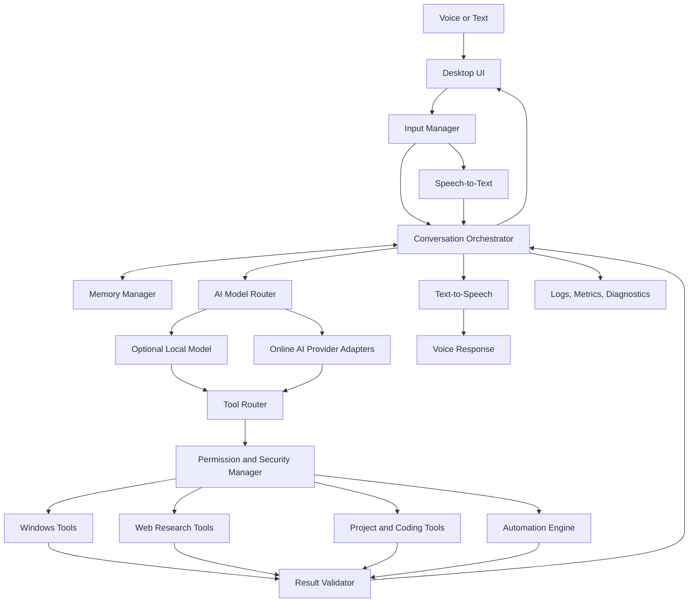

# FOXSI AI Voice Assistant — Master Blueprint

> Status: Architecture/specification only. This document describes the proposed system; it does not claim that the application has already been implemented or tested.
>
> Platform target: Native Windows 10/11 desktop, with no WSL requirement.
>
> Design goal: An extensible, security-conscious, Hindi/Hinglish-friendly personal voice assistant that can use online AI, optional local models, web research, and explicitly permitted Windows tools.

## 1. Vision and principles

FOXSI is intended to be more than a voice chatbot. It should combine voice interaction, an AI/model router, web research, Windows tools, project memory, coding assistance, task orchestration, and controlled automation.

Core principles:
- Modular design: swap AI providers, STT/TTS engines, and tools without rewriting the whole application.
- Hybrid-first: use online AI when useful and available; keep suitable operations local; add local models according to hardware.
- No false claims: report whether a task succeeded based on actual tool output and validation.
- Least privilege: tools receive only the access they need.
- Human approval: ask before destructive, external, costly, or security-sensitive actions.
- Observable execution: task status, useful logs, errors, and diagnostic results.
- Recoverability: timeouts, retries where safe, cancellation, and rollback where feasible.
- Privacy controls: users can inspect, export, and delete saved memories; never log secrets.
- Incremental delivery: implement and test each milestone before adding complexity.

## 2. Proposed architecture



### Major components

1. **Desktop UI:** chat, microphone state, task queue, approvals, model settings, memory controls, logs, and diagnostics.
2. **Input manager:** voice/text input, cancellation, and conversation state.
3. **Speech layer:** STT, TTS, optional wake word, device selection, interruption handling.
4. **Conversation orchestrator:** turns user intent into a plan, manages tool calls, tracks task status, and formats results.
5. **AI model router:** selects a configured provider based on task type, availability, privacy mode, latency, cost, and user settings.
6. **Tool router:** exposes only registered tools with validated schemas.
7. **Permission manager:** applies SAFE / CONFIRM / BLOCKED policy before execution.
8. **Memory manager:** conversation summaries, opt-in long-term memory, project notes, and task checkpoints.
9. **Web research engine:** searches, retrieves pages, extracts evidence, and returns source links with dates when available.
10. **Coding agent:** inspects repositories, proposes patches, runs allowed tests, and reports diffs and test outcomes.
11. **Automation engine:** queues multi-step jobs, supports cancellation, and records each step's status.
12. **Result validator:** checks tool output and verifies postconditions where possible.
13. **Diagnostics and logging:** startup self-checks, structured logs, dependency checks, and redaction of secrets.

## 3. AI strategy: online, local, and hybrid

### Online AI
Use configurable provider adapters for capable models, subject to provider terms, rate limits, availability, privacy policy, and possible usage fees. Never assume a hosted API is unlimited or free.

### Local AI
Support optional local inference runtimes and compatible models. Local model size, quantization, RAM, GPU architecture, VRAM, and context length determine speed and quality. Local inference is optional and should not block the core app from starting.

### Hybrid routing
Examples:
- Calculator, date formatting, and basic system inventory: local deterministic tools.
- Fresh information: web search and page retrieval, then AI synthesis.
- Complex coding or reasoning: an available configured AI provider.
- Offline mode: only local models and tools that have been installed and tested.
- Provider failure: report the issue and use a configured fallback only when permitted.

A local model does not make every feature offline. Web search and hosted services still require a network.

## 4. Voice capabilities

Planned features:
- Hindi, Hinglish, and English interaction where the selected engines support them.
- Push-to-talk as the reliable first mode.
- Optional wake-word detection after basic audio is stable.
- Configurable microphone and output device.
- STT and TTS adapters so engines can be replaced.
- Streaming text/audio where supported.
- Barge-in / interruption and cancellation where supported by the audio pipeline.
- Voice selection and optional local voice assets.
- Audio diagnostics and clear errors when a device or model is unavailable.

Do not promise a particular language accuracy, naturalness, or latency until tested on the chosen engine and hardware.

## 5. Windows tools and permission policy

Tools should be explicit, typed, allowlisted functions rather than unrestricted command execution.

### SAFE examples
- Read basic CPU/RAM/disk inventory.
- Open a user-approved application.
- Search within an approved workspace.
- Read an explicitly selected text file.
- Run a calculator or other deterministic helper.

### CONFIRM examples
- Delete or overwrite files.
- Install or uninstall software.
- Change system settings or startup behavior.
- Run shell commands outside a preapproved allowlist.
- Send messages, publish content, or make external changes.
- Execute code that changes a project or environment.

### BLOCKED examples
- Credential theft, covert surveillance, security-control bypass, or destructive actions without authorization.
- Any tool action prohibited by policy or applicable law.

Security requirements:
- Validate tool arguments and file paths.
- Restrict file tools to approved workspaces by default.
- Do not run as administrator unless a specific, justified feature requires it.
- Never execute untrusted web-page or document instructions as system commands.
- Require explicit approval for irreversible or externally visible actions.
- Keep an audit trail of tool name, task ID, outcome, and timestamp without recording secrets.
- Support cancellation and safe timeouts.
- Treat browser content, repository content, and downloaded files as untrusted input.

## 6. Memory design

Use SQLite for structured local state in the initial version.

Memory categories:
- **Session memory:** current conversation state.
- **Long-term memory:** user-approved preferences and facts.
- **Project memory:** repository paths, architecture decisions, and next steps.
- **Task memory:** plans, completed steps, failures, and resumable checkpoints.

Controls:
- Memory can be disabled.
- Show, edit, export, or delete saved items.
- Store only useful information with a clear purpose.
- Do not store passwords, API keys, or other secrets in memory.
- Make it clear when data is sent to an online provider.

## 7. Web research engine

Planned workflow:
1. Interpret the research question.
2. Generate focused search queries.
3. Retrieve relevant pages using configured search/browser tools.
4. Extract claims, dates, and source URLs.
5. Prefer official and primary sources for government, product, and policy facts.
6. Compare sources and flag conflicts or missing evidence.
7. Produce a concise answer with links and uncertainty notes.
8. Save research artifacts only when requested or configured.

Search results are evidence, not trusted instructions. Web access depends on the chosen provider, connectivity, website access rules, and tool availability.

## 8. Coding agent

Capabilities to implement incrementally:
- Inspect repository structure and project configuration.
- Read relevant files and identify dependencies.
- Create a plan before making broad changes.
- Prefer a separate Git branch or isolated workspace.
- Present diffs for review.
- Run tests, linters, and diagnostics only through approved tools.
- Report exact commands and actual test results.
- Avoid committing secrets or generated artifacts.
- Never claim tests passed if they were not run.
- Require confirmation before pushing, publishing, deploying, or overwriting important work.

Suggested workflow: understand request → inspect project → plan → propose patch → approve → apply in isolated workspace → test → review diff → report result.

## 9. Multi-agent and multitasking plan

Possible later agents:
- Main/orchestrator agent: owns task state and final reporting.
- Research agent: gathers source-backed information.
- Coding agent: implements scoped changes.
- Review agent: examines diffs, tests, and risks.
- System tools agent: uses permitted local functions.
- Memory agent: retrieves and updates approved project context.

Controls:
- Central task queue and shared task state.
- Per-agent tool permissions.
- Concurrency limits based on hardware and provider limits.
- Avoid simultaneous writes to the same files.
- Cancellation, deadlines, and retry limits.
- Validate outputs before accepting them.
- Track provider costs/rate limits when available.

More agents do not automatically mean faster or better results; concurrency must be measured.

## 10. Desktop UI

Initial screens:
- Home / Chat: voice and text interaction.
- Tasks: queued, running, completed, cancelled, and failed jobs.
- Agents: configured agents and their current assignments.
- Models: provider settings, model selection, fallback behavior.
- Voice: input/output devices, STT/TTS engine, wake word.
- Memory: view and delete saved items.
- Automation: configured rules and execution history.
- Security: permissions, allowlists, approval settings.
- Logs: errors and tool execution history.
- Diagnostics: environment and service checks.

Always show when the microphone is active, when a task is running, and when user approval is required.

## 11. Suggested technology choices

These are candidates, not locked dependencies; verify current Windows support, licensing, and compatibility before implementation.

| Layer | Candidate | Purpose |
|---|---|---|
| Main language | Python | AI, audio, and automation ecosystem |
| Desktop UI | HTML/CSS/JavaScript with a suitable desktop shell | Cross-layer UI |
| Local API | FastAPI | Typed local service endpoints |
| State | SQLite | Local structured storage |
| Configuration | YAML or TOML | Human-readable settings |
| STT | Faster-Whisper or another tested engine | Speech recognition |
| TTS | Piper or another compatible engine | Speech output |
| Local inference | llama.cpp-compatible runtime where appropriate | Optional local models |
| Testing | pytest | Automated tests |
| Version control | Git/GitHub | Change history and collaboration |
| Logging | Python logging or structured logging library | Diagnostics and audit events |

Start as a **modular monolith**, not a microservice cluster. Split services only when a measured need justifies the complexity.

## 12. Proposed repository structure

```text
FOXSI/
  app/
    main.py
    api/
    core/
      orchestrator.py
      task_manager.py
      event_bus.py
    ai/
      model_router.py
      local_provider.py
      cloud_provider.py
    speech/
      stt.py
      tts.py
      wakeword.py
      audio_manager.py
    tools/
      router.py
      permissions.py
      system_tools.py
      file_tools.py
      browser_tools.py
    agents/
      research_agent.py
      coding_agent.py
      review_agent.py
    memory/
      database.py
      retrieval.py
    automation/
    security/
    diagnostics/
  frontend/
  models/          # optional; do not commit large model files
  voices/          # optional voice assets; review licenses
  data/            # local runtime data; normally ignored by Git
  logs/            # runtime logs; normally ignored by Git
  tests/
  config.yaml
  requirements.txt
  .env.example
  .gitignore
  README.md
  install.bat
  start.bat
  stop.bat
  diagnostics.bat
```

The actual layout can evolve as modules are implemented. Do not commit private data, real API keys, personal recordings, logs, or large model weights.

## 13. Windows setup and diagnostics scripts

- **install.bat:** check supported Python version, create a virtual environment, install pinned dependencies, create required folders, and report failures.
- **start.bat:** validate configuration, run startup checks, and launch the app.
- **stop.bat:** request graceful shutdown and stop only processes started by this application.
- **diagnostics.bat:** report OS, Python, CPU/RAM/disk/GPU availability, dependency state, audio devices, model paths, and recent sanitized errors.

Scripts must not silently disable security tools, modify unrelated system settings, or require administrator rights by default.

## 14. Hardware planning

Actual requirements depend on model size, quantization, STT/TTS choices, concurrency, Windows background load, and budget. Treat these as planning tiers, not guaranteed minimums.

| Tier | Indicative RAM | GPU | Expected use |
|---|---:|---|---|
| Online-first starter | 8 GB can be workable; 16 GB preferred | Integrated graphics may suffice | UI, online AI, basic tools |
| Balanced hybrid | 16–32 GB | Integrated graphics for many basics; dedicated GPU optional | Online AI plus small local models |
| Local-model focused | 32–64 GB or more depending on model | Select by actual VRAM/model needs | More capable local inference and heavier concurrency |

Additional guidance:
- SSD: 512 GB is a practical starting point; 1 TB offers more room for development and models.
- A reliable headset or USB microphone improves usability.
- Stable internet is needed for online providers and web research.
- GPU choice must be based on model compatibility, VRAM, bandwidth, power, cooling, and budget—not only the GPU name.
- A powerful GPU is not required to begin with online AI.
- Keep upgrade paths in mind where possible.

Before buying hardware, decide whether the priority is online-first, balanced hybrid, or larger local models. Compare actual parts and current local prices before purchasing. Do not buy a GPU solely on the assumption that every AI feature needs one.

## 15. Delivery roadmap

### Phase 0 — Specification and risk review
- Finalize feature priorities, target Windows versions, privacy policy, and budget.
- Confirm licenses and compatibility of selected dependencies.
- Define acceptance tests.

### Phase 1 — Core application
- Project skeleton, configuration, logging, diagnostics, task state, and basic desktop UI.
- Startup and shutdown behavior.
- Tests for core state and error handling.

### Phase 2 — Voice I/O
- Push-to-talk first.
- STT/TTS adapters, device selection, cancellation, and audio diagnostics.
- Test language behavior and latency on target hardware.

### Phase 3 — AI provider router
- One provider adapter first.
- Configuration and secret handling.
- Timeouts, rate-limit errors, and optional fallback.
- Do not assume unlimited/free API access.

### Phase 4 — Web research
- Search and retrieval adapters.
- Source links, dates where available, and uncertainty reporting.
- Tests for malformed or inaccessible pages.

### Phase 5 — Safe Windows tools
- Allowlisted read-only tools first.
- Permission policy and confirmation UI.
- Add file and application operations only after path validation and tests.

### Phase 6 — Memory and coding agent
- SQLite memory with user controls.
- Repository inspection and isolated patch workflow.
- Test execution and diff review.

### Phase 7 — Automation and multi-agent orchestration
- Task queue, bounded concurrency, cancellation, checkpoints, and validation.
- Agent-level permissions and conflict handling.

### Phase 8 — Optional local AI and polish
- Benchmark local models on the actual hardware.
- Add wake word, screen understanding, and other advanced features only after the base system is stable.

For each phase: implement → test → fix → verify → document. Do not move on based solely on a successful launch.

## 16. Acceptance criteria

A release is not complete merely because the window opens. The initial usable release should demonstrate that:
- Text interaction works.
- At least one configured AI provider responds, or the app clearly reports why it cannot.
- Voice input/output works with the selected engines, when installed.
- Web research returns source links.
- Safe tools execute only through the tool router.
- Confirmation is required for defined risky operations.
- Memory can be inspected and deleted.
- Secrets are redacted from logs.
- Errors, timeouts, cancellation, and offline limitations are clearly reported.
- Startup and diagnostics scripts run actual checks.
- Automated tests cover core logic and permissions.
- Git diffs are reviewable and changes can be rolled back where feasible.
- Offline features have actually been tested without a network before being advertised as offline-capable.

## 17. Risks and mitigations

| Risk | Mitigation |
|---|---|
| Free online AI limits or service changes | Provider adapters, transparent limits, optional local fallback |
| Low-end hardware overload | Lazy-load models, bounded concurrency, resource checks |
| Wrong or outdated web claims | Source links, date checks, uncertainty notes |
| Prompt injection from web/files | Treat retrieved content as untrusted data; never as privileged instructions |
| Destructive PC actions | Allowlist, confirmation, workspace limits, audit logs |
| Coding regressions | Isolated branch/workspace, tests, diff review |
| Secrets leaking | Environment-based configuration, redaction, Git ignore rules |
| Dependency/license issues | Pin versions and review licenses/maintenance |
| Misleading success reports | Verify postconditions and report actual tool results |

## 18. Future expansion

After the core system is reliable, consider:
- OCR and screen understanding.
- PDF and document knowledge base.
- Scheduled reports and reminders.
- More provider adapters and local model options.
- GitHub issue/PR workflows.
- Optional mobile or secure remote dashboard.
- User-defined plugins with explicit permissions.
- More natural voice and low-latency streaming.
- Backup/export and restore for configuration and approved memory.

Remote access should be a later milestone because it requires strong authentication, secure transport, and access-control review.

## 19. Decisions still open

These decisions must be made before locking the implementation:
1. Budget and hardware target.
2. Online-first vs balanced hybrid vs local-model focused.
3. Preferred UI style and whether a system tray mode is needed.
4. Which AI provider(s) are available and acceptable for privacy/cost.
5. Required Hindi/Hinglish STT/TTS quality.
6. Whether wake-word listening should be enabled.
7. Which folders and Windows actions the assistant may access.
8. Which features belong in the first release versus later milestones.

## 20. Immediate next steps

1. Review this blueprint and the existing `Prompt` file together.
2. Choose an initial hardware tier and budget before buying components.
3. Finalize Phase 1 acceptance tests and dependency choices.
4. Build the smallest runnable vertical slice: desktop UI → text input → one AI adapter → response.
5. Add voice I/O and safe tools only after the core slice is tested.
6. Keep implementation, test results, and known limitations documented in GitHub.

**Current scope:** This file is a plan. No runnable FOXSI application, dependency lock, hardware benchmark, or tested feature is implied by this document.
